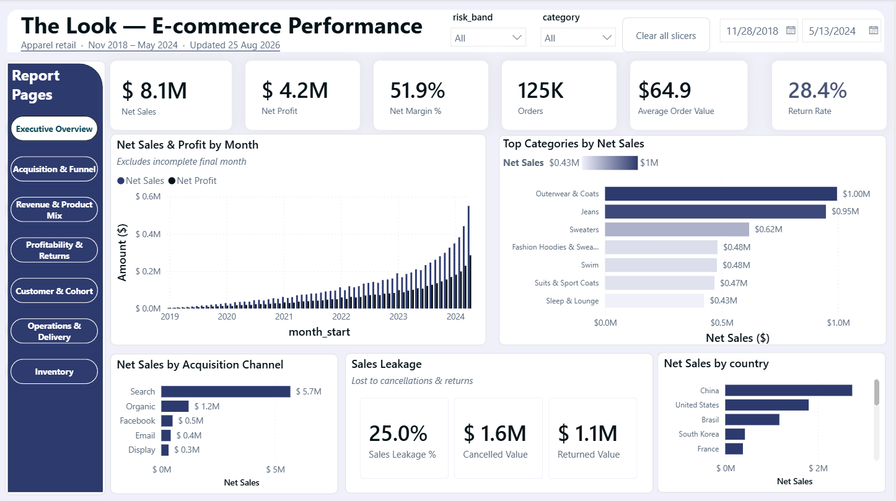
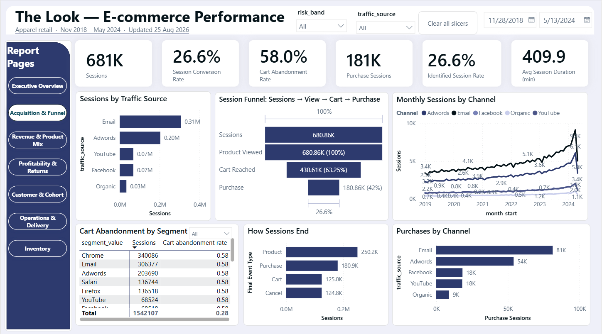
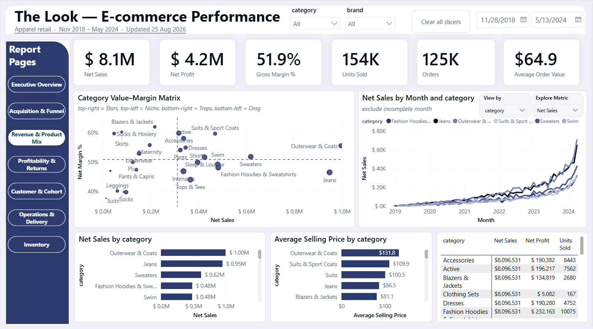
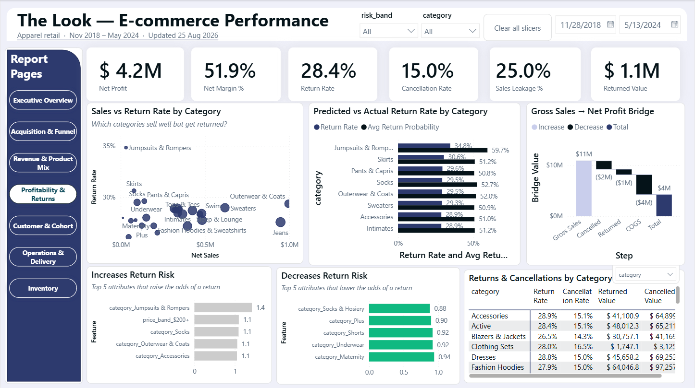
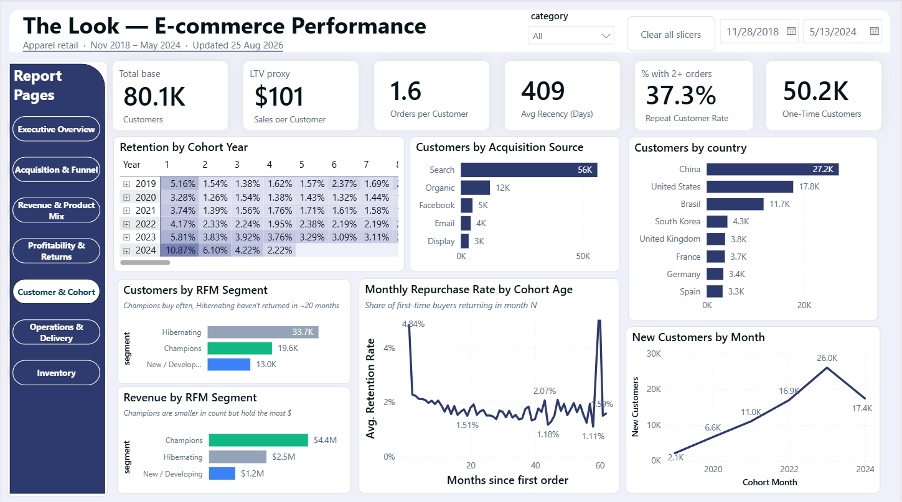
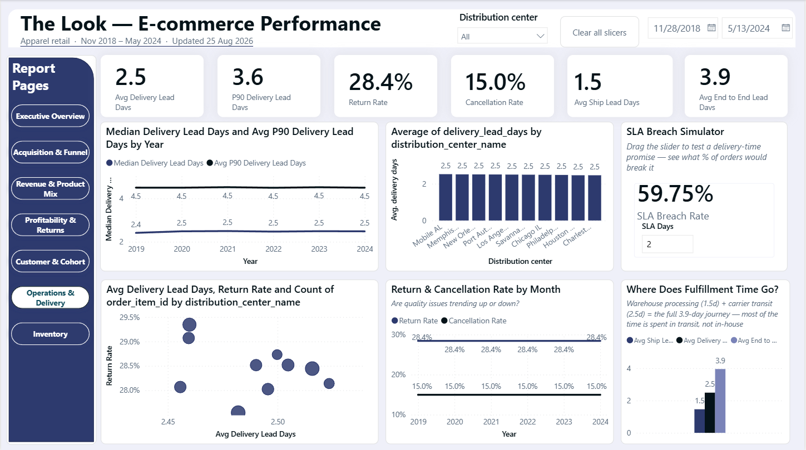
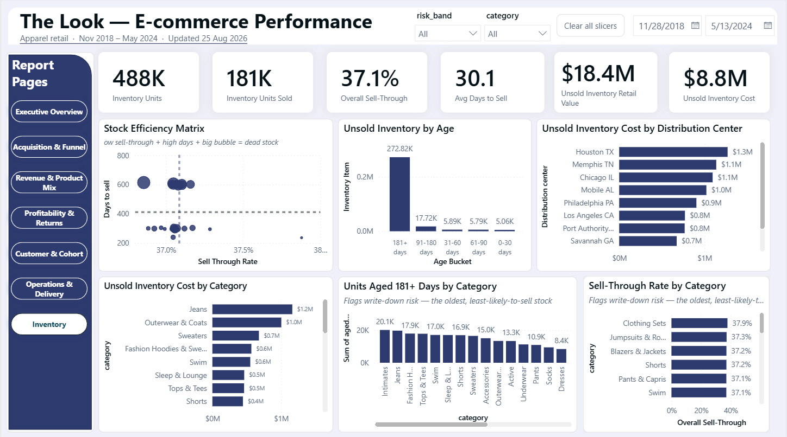
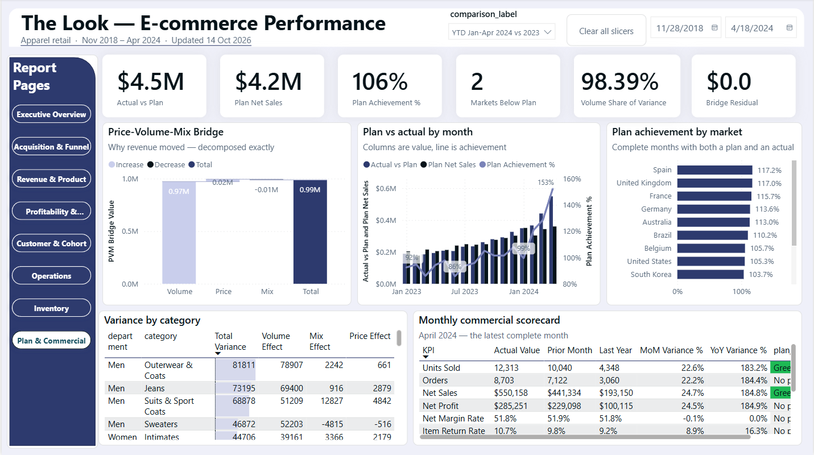
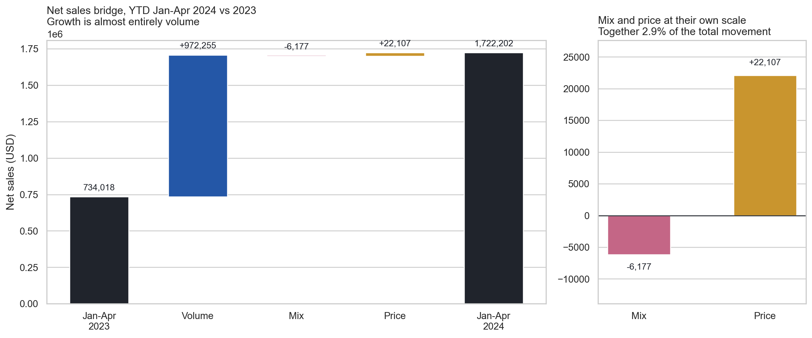
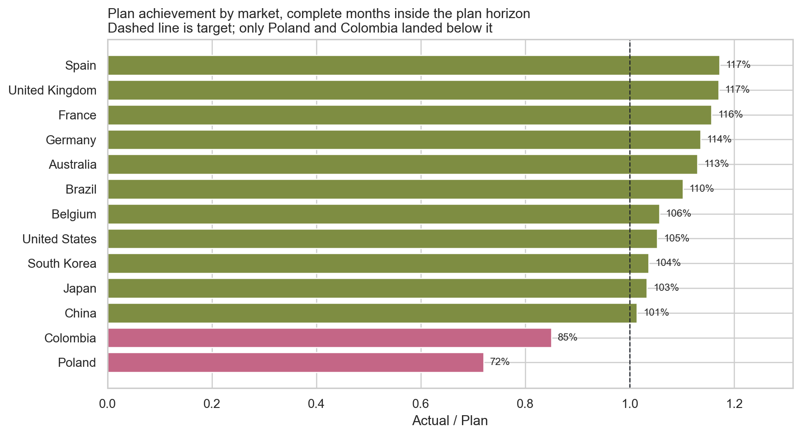

# The Look eCommerce — Commercial Analytics, Planning & BI Pipeline

**SQL data warehouse · commercial planning & variance · price-volume-mix · Power BI + Excel management pack — two source systems, reproducible with one command.**

🔗 **Live dashboard:** [View the interactive Power BI report](https://app.powerbi.com/view?r=eyJrIjoiNmZiNzVmYzQtZTE4OC00ZTM0LThmZDYtNThmMzQ5MjljNGMxIiwidCI6IjNkZmNkMTY2LWYzZmUtNGQxNS1hNDYzLTA0NTU2YzMwNWZmMiIsImMiOjEwfQ%3D%3D)

---

## 1. Executive Summary

This project takes the **seven original TheLook eCommerce source files** (a synthetic but
realistically messy retail dataset) and turns them into a decision-ready analytics product:
a tested **DuckDB star-schema warehouse**, a layer of **Python statistical & machine-learning
analysis**, and an **8-page Power BI dashboard** for executives, marketing, operations, and
merchandising.

**The elevator pitch.** Starting from ~2.4M raw events and ~125k orders, I rebuilt sessions
from event logs, modeled a conformed star schema, consolidated a second source system of
regional plan submissions, and built the planning and variance layer a commercial team runs
on — a price-volume-mix bridge, plan-versus-actual by market, a quality and reconciliation
layer, and a monthly management pack in Excel. The warehouse quantifies the full
commercial picture —
**\$8.10M net sales**, **\$4.20M net profit (51.9% margin)**, a **26.6% session-to-purchase
conversion**, a **58% cart-abandonment rate**, and a **28.4% item-return rate**. On top of the
warehouse I ran a Gini-coefficient concentration analysis and RFM customer segmentation,
both reported with the population and the method stated rather than assumed.

### Headline metrics (full history; latest partial month excluded from period comparisons)

| Metric | Value | Metric | Value |
|---|---|---|---|
| Gross Sales | **\$10,796,336** | Sessions | **680,862** |
| Net Sales | **\$8,096,531** | Session Conversion Rate | **26.56%** |
| Net Profit | **\$4,201,367** | Cart Abandonment Rate | **58.00%** |
| Net Margin | **51.9%** | Observed Return Rate | **28.43%** |
| Orders | **124,814** | Item Cancellation Rate | **14.97%** |
| Customers | **80,095** | Repeat Customer Rate | **37.29%** |

### Dashboard preview


*Executive Overview — headline KPIs, monthly net sales & profit, top categories, sales leakage.
The live report above has 8 pages in total; the rest are below.*

<details>
<summary><strong>See all 8 dashboard pages</strong> (click to expand)</summary>


*Acquisition & Funnel — sessions by channel, cart-to-purchase funnel, abandonment by segment.*


*Revenue & Product Mix — category value-margin matrix, units sold trend, average selling price.*


*Profitability & Returns — return-risk model outputs, gross-to-net profit bridge, top return drivers.*


*Customer & Cohort — RFM segments, retention curve, repeat-purchase rate by cohort age.*


*Operations — delivery lead-time breakdown by stage, SLA breach simulator (what-if parameter).*


*Inventory — stock efficiency matrix, unsold inventory age & cost, sell-through by category.*


*Plan & Commercial — plan achievement against submitted regional targets, the price-volume-mix
bridge with a residual of $0.00, achievement by market, and the monthly commercial scorecard.
This is the page the commercial layer was built for.*

</details>


---

## 2. Business Problem & Goals

**The problem.** Raw transactional logs answer *nothing* on their own. Leadership could not see
where revenue leaks to cancellations and returns, which customers are worth retaining, which
channels convert, where delivery is slow, or where cash is trapped in unsold stock — because the
data lived in seven disconnected files with messy types, censored outcomes, and no session model.

**The goal.** Build a single trustworthy pipeline that answers the questions each team actually
asks, and hand it off as a self-service dashboard:

| Stakeholder | Question the project answers |
|---|---|
| **Executive** | How much are we really making after cancellations and returns, and is it growing? |
| **Marketing** | Which acquisition channels bring volume *and* quality (conversion, retention)? |
| **Merchandising** | Which categories drive revenue vs. margin, and which get returned? |
| **CRM / Retention** | Who are our Champions vs. Hibernating customers, and how fast do cohorts churn? |
| **Operations** | Where is delivery slow, and where do returns concentrate? |
| **Inventory** | Where is stock aging and tying up cash? |
| **Commercial / Planning** | Are we on plan by market, was the movement volume price or mix, and are we going to land the year? |

**Primary KPIs targeted:** Net Sales, Net Profit & Margin, AOV, Session Conversion, Cart
Abandonment, Observed Return Rate, Repeat-Customer Rate, Cohort Retention, Sell-Through, and
Days-to-Sell.

---

## 3. Tech Stack

| Layer | Tool | Role |
|---|---|---|
| **Extract / orchestration** | **Python** (`pandas`, `duckdb`) | Read the 7 source CSVs, drive the build, enforce contracts |
| **Transform / warehouse** | **SQL on DuckDB** (`raw → stg → core → mart → qa`) | Typing, session reconstruction, star schema, decision marts, tests |
| **Analytics & ML** | **Python** (`scikit-learn`, `numpy`, `matplotlib`, `seaborn`) | Gini/Lorenz concentration analysis, RFM K-means segmentation, logistic-regression return model |
| **Planning & variance** | **SQL on DuckDB** (`08_commercial_planning`, `09_quality_commercial`) | Second-source ingestion, country harmonisation, budget-FX conversion, plan quarantine, PVM bridge, scorecard |
| **Reporting** | **Power BI** (star schema, DAX, drill-through, field parameters, what-if) | 8-page executive-to-operations dashboard |
| **Management pack** | **Excel** (`openpyxl`) | 6-sheet formatted workbook regenerated from the warehouse on every run |

This is a **local ELT pipeline** — run entirely on one machine, loading raw first and then
transforming *inside* the warehouse with SQL (`raw → stg → core → mart → qa`), the pattern most
analytics-engineering roles use today. Everything is triggered by **one command** — what that command runs, how to run a single
stage while developing, and why the work is split across ten SQL files and thirteen Python
modules is set out in [`docs/how_to_run.md`](docs/how_to_run.md).

> **Full architecture** — the layer diagram, layer responsibilities, declared grains, source
> contract, and event-to-session derivation are documented in
> [`docs/technical_reference.md`](docs/technical_reference.md).


---

## 4. Commercial Planning, Variance & Quality

> Full methodology, assumptions and the list of what this dataset *cannot* support:
> [`docs/commercial_analytics.md`](docs/commercial_analytics.md).

### A second source system

Plan data never comes from the transactional system. It arrives from regional teams as a
spreadsheet, in local currency, sometimes late and sometimes incomplete. This project adds
that second source — `data/planning/regional_plan_submissions.csv` — and runs it through the
same `raw -> stg -> core -> mart -> qa` discipline as the sales data.

**The planning file is a constructed scenario, not source data.** TheLook ships no budget
data. It is generated by `src/build_plan_source.py` from a stated, reproducible rule
(prior-year actual, times the growth rate visible at planning time, times a per-market
ambition factor) and is labelled as constructed everywhere it appears.

### Master data was genuinely broken

`users.csv` contains `Espana` alongside `Spain`, `Deutschland` alongside `Germany`, and
`Brasil` for Brazil. Left alone, country reporting splits single markets into phantom ones.
`seeds/country_master.csv` maps all sixteen observed spellings to thirteen canonical markets
and three regions. Three of the sixteen were aliases.

### Validation: what blocks, and what does not

Of 292 submitted plan rows, **287 were accepted and 5 quarantined** with a stated reason.
Twelve commercial checks run: **8 PASS, 4 WARN, 0 FAIL.**

Checks run in **two phases**. Nine source-level checks run before any model is built, so a
broken extract never gets modelled - including two that catch a *new* value rather than a
known bad one: every country spelling must map to a canonical market, and every plan
currency must have a budget FX rate. The remaining twenty-six compare one layer against
another and run after the warehouse exists. **Nothing is exported until both phases pass**,
so a failing build cannot leave stale CSVs or a stale Excel pack on disk.

Structural defects block the build, because they make the consolidated number *wrong*:
unmapped country, broken grain, FX that does not reproduce, a consolidation that does not tie,
or a bridge whose effects do not sum. Submission defects do not block, because they make the
plan *incomplete* rather than wrong — the review still has to happen, and the defect goes back
to the region.

The coverage check earned its place by surfacing three different root causes at once: Colombia
is too small to plan at all (16 gaps), Poland submitted late (3), and five single-month gaps
are the quarantined rows showing up downstream.

### Price-Volume-Mix bridge



Net sales grew $734K to $1.72M YTD Jan-Apr 2024 vs 2023. The decomposition is exact — the
three effects sum back to total variance, and a test asserts the residual is below $0.01.

| Effect | Value | Share |
|---|---|---|
| Volume | +$972,255 | 98.4% |
| Price | +$22,107 | 2.2% |
| Mix | -$6,177 | -0.6% |

ASP moved $59.59 to $60.15, under 1%. **Growth is almost entirely volume.** The business is
not pricing up and not shifting into premium categories, which means growth is exposed to any
slowdown in traffic or conversion — and that price and mix are unexploited levers.

### Plan versus actual



| Region | 2023 | 2024 YTD |
|---|---|---|
| AMER | 97.9% | 126.5% |
| APAC | 94.2% | 122.2% |
| EMEA | 105.9% | 140.5% |

2023 landed close to plan in all three regions. 2024 runs far ahead everywhere because the
plan was built on the prior year growth rate and actual growth accelerated — a property of the
synthetic generator curve, named here rather than presented as outperformance.

Only **Poland (72%)** and **Colombia (85%)** are below plan across complete months — the same
two markets the coverage check flagged.

### Forecasting — reviewed and delivered

Three candidate methods compared on a rolling-origin backtest rather than on in-sample
fit, with a deliberately weak benchmark kept as the bar the others have to clear.

| Model | MAPE across the 8-month horizon | 1 month out | 8 months out | Mean bias |
|---|---|---|---|---|
| **`seasonal_naive_drift`** ← selected | **8.0%** | 6.5% | 11.5% | −0.7% |
| `holt_winters_log` | 26.0% | 8.3% | 43.5% | +8.3% |
| `seasonal_naive` (benchmark) | 42.4% | 41.7% | 44.2% | −42.4% |

**24 rolling origins × 8 steps = 192 folds.** Each origin refits on history available at
that origin only. The per-fold detail is in `mart.forecast_backtest_detail`, so the
horizon decay can be queried rather than trusted.

The module was held back from every presented surface until it had been audited to the
standard of the warehouse. [`docs/forecast_review.md`](docs/forecast_review.md) is that
audit: seven checks specified in advance, of which **two found a defect and were fixed,
two tested a hypothesis that turned out to be wrong, and three passed.**

The headline defect: the backtest scored every model **one month ahead** and then ran the
winner **eight months ahead**. At one month the two serious candidates look comparable
(7.1% vs 11.8%) and split the folds three-three; across the full horizon they are 8.0%
and 26.0%. The champion was unchanged, but the original design had no power to tell them
apart.

**Read the numbers with two limitations.** TheLook is synthetic, so its growth curve is
smoother than real demand and an 8.0% MAPE is optimistic. And the plan the forecast is
compared against is constructed by `src/build_plan_source.py` from a documented rule —
TheLook ships no budget data — so `mart.forecast_vs_plan` compares a real forecast with a
synthetic target.

**Follow it step by step in Excel.**
[`reports/forecast_start_to_end.xlsx`](reports/forecast_start_to_end.xlsx) rebuilds the
forecast with live formulas: data, settings, one practice test, the 192-fold backtest,
scores, the original one-month design, the forecast and its drift clip, scenarios, the
country split, forecast vs plan, and the seven review checks. It matches this module on
13 reconciliation checks. Holt-Winters predictions are pasted in from Python, because Excel
cannot refit statsmodels exactly. The workbook was built once from the warehouse and is not
regenerated by `run_all.py`.

### Management pack

[`reports/commercial_management_pack.xlsx`](reports/commercial_management_pack.xlsx) — six
formatted sheets (Scorecard, Plan vs Actual, Price-Volume-Mix, Forecast, Data Quality,
Definitions) with conditional formatting, charts and number formats, regenerated from the
warehouse on every build so it cannot drift from the dashboard.

### What this dataset cannot support

Price elasticity, promotion effectiveness, marketing incrementality and multi-touch attribution
are **not** built, because the data cannot support them honestly — there is no discount field,
no campaign table, no marketing cost, and one traffic source per session. Section 9 of
[`docs/commercial_analytics.md`](docs/commercial_analytics.md) states each one, the blocking
limitation, and the data and method that would be required.

---

## 5. Key Insights & Recommendations

> Insights below combine the warehouse-computed metrics with a page-by-page read of the built
> Power BI dashboard. The dataset is **synthetic**, so patterns reflect its generator, not a real
> market — the transferable value is the *method*. Full metric tables are in
> [`docs/analysis_and_findings.md`](docs/analysis_and_findings.md).

**Core discoveries, grouped by dashboard page**

*Acquisition & Funnel*

- **Two channel lenses give two different leaders.** Email leads by session volume (306K
  sessions), but Search leads by acquisition-attributed net sales (\$5.7M — more than 4x the next
  source). Budget decisions should be anchored to the value lens, not the volume lens.
- **The funnel loses a comparable number of sessions at each stage, but at very different rates.**
  Product-view → cart loses 250K sessions (a 37% drop); cart → purchase loses a nearly identical
  250K sessions, but that's a much steeper 58% drop from a smaller base. Cart abandonment is the
  standout *rate*, even though discovery-to-cart loses almost as many sessions in absolute terms.
- **Cart abandonment sits close to 58% across nearly every channel and browser shown** — checkout friction is one hypothesis to investigate. Similar aggregate rates do not identify the cause or rule out channel and browser effects.

*Revenue, Growth & Geography*

- **Revenue survives cancellations and returns, but not cheaply.** \$10.80M gross becomes \$8.10M
  net (−\$1.6M cancelled, −\$1.1M returned) — a **25% leakage** that Ops and merchandising can
  attack directly.
- **The monthly chart looks like an accelerating hockey stick — the underlying growth rate isn't
  actually accelerating.** Year-over-year net sales growth peaked in 2020 (+227%, off a small
  base) and has settled into a fairly steady 71–76% range for 2022–2023. The hockey-stick shape
  is compounding on a growing base, not a genuine speed-up in the growth *rate*.
- **China is the single largest net-sales market**, ahead of the United States — worth flagging in
  case it differs from what a stakeholder expects.

*Customers & Retention*

- **Spending is concentrated (Gini ≈ 0.58).** A minority of customers drive a disproportionate
  share of revenue — a retention test is worth investigating; comparative economics require intervention cost and incremental-response evidence.
- **Champions are a small slice that punches far above its weight.** Champions are only 29.5% of
  segmented customers (19,550 of 66,215) but generate 63.3% of the combined Champions+Hibernating
  net sales (\$4.39M vs. \$2.55M from 33,688 Hibernating customers).
- **Newer purchase cohorts show higher month-1 retention than older ones** — a promising signal,
  but it's based on fewer complete months of data; worth re-checking once 2024 finishes before
  treating it as a confirmed trend rather than noise.

*Product & Profitability*

- **Jumpsuits & Rompers is a clear return-rate outlier** (~35%, vs. 28–30% for most other
  categories) — a candidate for targeted investigation rather than a category-wide policy change.
- **The return-risk model's predicted probabilities run roughly double the actual return rate in
  every category** (e.g., Jumpsuits: 34.8% actual vs. 59.7% predicted). This aggregate comparison raises a separate calibration concern; ROC-AUC near 0.50 describes weak ranking and does not itself measure calibration.
- **The return model is honestly weak (AUC ≈ 0.50).** On the available pre-outcome features there
  is little signal; the right recommendation is *better feature/outcome logging*, not deploying a
  weak model.

*Operations & Fulfillment*

- **Delivery is uniform (~2.5 days median across all DCs).** No single distribution center is a
  bottleneck in this data — so the fulfillment lever is carrier transit, which is ~62% of the
  end-to-end clock.
- **A 2-day delivery promise would currently be breached by ~60% of orders**, per the dashboard's
  SLA breach simulator — a concrete number for setting realistic delivery-time claims before
  marketing an expedited-shipping option.

*Inventory*

- **Aged stock dominates the unsold-inventory snapshot.** The
  181+ day age bucket alone holds ~273K unsold units — nearly 8x as many as all three younger
  buckets combined (~34K).
- **Houston TX carries the single highest unsold-inventory cost** among distribution centers
  (\$1.3M) — a candidate for a first clearance/markdown pass.

> **A pattern to read carefully:** several operational dimensions — delivery lead time by year and
> by distribution center, sell-through rate by category, cart abandonment by channel/browser —
> show unusually little variation on this dataset. That's consistent with this being a synthetic,
> generator-driven dataset rather than a genuine "everything performs identically" operational
> result, and it's worth naming explicitly rather than presenting flat charts as confirmed findings.

**Strategic actions, grouped by owner**

*Customer & Retention*

1. **Protect Champions, reactivate Hibernating.** Champions generate nearly double the revenue of
   Hibernating from fewer than half as many customers — loyalty perks for the high-value tail, and
   a low-cost win-back to the 33.7K Hibernating customers where even a small lift compounds.
2. **Validate the newer-cohort retention signal before acting on it.** Re-check month-1 retention
   by cohort once 2024 is a complete year; if the improvement holds, identify what changed
   (onboarding, product mix, channel mix) around the shift.

*Channel & Acquisition*

3. **Anchor acquisition budget to value, not volume.** Search has the largest acquisition-attributed net sales in this dataset; Email has the most sessions. Compare those scopes before forming a budget hypothesis. Without spend and incremental-outcome data, neither is a demonstrated channel-efficiency ranking.
4. **Treat checkout/cart experience as the highest-*rate* leak, without deprioritizing
   discovery-to-cart.** Cart abandonment (58%) is the steepest single-stage drop, but
   product-view-to-cart loses a comparable number of sessions (37% of a larger base) — both
   deserve investment, not just checkout.

*Product & Returns*

5. **Attack the 25% revenue leakage** via returns/cancellation root-cause work on the highest-\$
   categories (Outerwear & Coats, Jeans, Suits & Sport Coats lead net sales).
6. **Investigate Jumpsuits & Rompers specifically** (sizing guidance, fit info, product imagery)
   given its outlier return rate, rather than a blanket returns-policy change.
7. **Improve return-risk feature/outcome logging before trusting a model.** The current
   ROC-AUC ≈ 0.50 means the honest recommendation is better inputs, not a weak model in production.

*Operations & Fulfillment*

8. **Don't advertise a 2-day delivery guarantee without operational change first.** Current
   fulfillment would breach that promise on roughly 60% of orders today.

*Inventory*

9. **Prioritize a clearance/markdown review at the Houston TX distribution center**, which carries
   the highest unsold-inventory cost.
10. **Treat the 90–180 day unsold window as the actionable intervention point** (discount, bundle,
    redistribute) — the snapshot identifies a large aged-stock balance, but does not estimate its future probability of sale.

---

## 6. Repository Structure

```text
new_analysis/
├── README.md                     # This file — start here
├── requirements.txt              # Python dependencies
├── seeds/                        # Committed reference data
│   ├── country_master.csv        #   16 source spellings -> 13 markets, 3 regions
│   ├── fx_budget_rates.csv       #   Fixed budget FX rates
│   └── country_currency.csv      #   Market -> submission currency
├── data/planning/                # Second source: regional plan submissions
├── src/                          # ETL + analytics automation
│   ├── pipeline.py               #   Extract + run the SQL warehouse build
│   ├── build_plan_source.py      #   Generate the plan file (one-time, documented rule)
│   ├── advanced_analytics.py     #   Gini concentration + RFM segmentation
│   ├── forecasting.py            #   Backtest, scenarios, forecast vs plan
│   ├── build_excel_pack.py       #   6-sheet commercial management pack
│   ├── render_outputs.py         #   Figures from warehouse queries
│   ├── render_commercial_figures.py  # PVM and plan-achievement figures
│   ├── build_notebooks.py        #   Regenerate notebooks 01 & 03 from live numbers
│   ├── build_commercial_notebook.py  # Regenerate notebook 05
│   ├── build_project_walkthrough.py  # Regenerate notebook 00
│   ├── explore.py                #   Read-only workbench helpers (not in the pipeline)
│   ├── build_code_map.py         #   Regenerate docs/code_map.md from the files
│   ├── build_data_catalogue.py   #   Regenerate docs/warehouse_catalogue.md from the warehouse
│   ├── validate_project.py       #   Final gate (DB exists, all three QA gates pass)
│   └── run_all.py                #   One-command orchestrator
├── sql/
│   └── duckdb/                   # 00_raw_quality → 09_quality_commercial, run in name order
├── notebooks/
│   ├── 00_project_walkthrough.ipynb              # The whole project in one readable pass
│   ├── 01_data_quality_and_core_analysis.ipynb   # core commercial / cohort / DQ (generated)
│   ├── 02_statistical_deep_dives.ipynb           # Gini · RFM (hand-authored)
│   ├── 03_event_sessionization_audit.ipynb       # session lineage proof (generated)
│   ├── 05_commercial_planning_and_forecast.ipynb # plan, variance, PVM (generated)
│   └── 90_workbench.ipynb                        # read-only exploration (hand-edited, never generated)
├── power_bi/                     # DAX, theme, data model, blueprint, build README
│   └── the_look_ecommerce_performance_dashboard.pbix   # (local only — 97MB, git-ignored)
├── docs/                         # Analysis, technical reference, dictionaries, how-to-run, walkthrough HTML
├── reports/                      # The Excel management pack + forecast walkthrough
├── data/processed/advanced/      # Model deliverables (committed)
├── artifacts/                    # figures/ + metrics JSON (warehouse git-ignored)
└── private_review/               # Internal notes, presentation prep, superseded work (git-ignored)
```

**The docs:**

| Doc | Audience | Content |
|---|---|---|
| [`docs/analysis_and_findings.md`](docs/analysis_and_findings.md) | Business reviewer | Questions, results, advanced methods, limitations |
| [`docs/technical_reference.md`](docs/technical_reference.md) | Data engineer | Architecture, sources, session derivation, tests, assumptions |
| [`docs/kpi_dictionary.md`](docs/kpi_dictionary.md) | Anyone checking a number | 25 KPI definitions with grain, source, caveat |
| [`docs/data_dictionary.md`](docs/data_dictionary.md) | Anyone using the data model | Dimension / fact / mart field reference |
| [`docs/warehouse_catalogue.md`](docs/warehouse_catalogue.md) | Anyone writing a query | **Every table and every column** - 65 objects, 674 columns, with type, nulls, distinct count and a real example |
| [`docs/code_map.md`](docs/code_map.md) | Anyone reading the code | Every warehouse object to the file and line that builds it, plus what each Python module owns |
| [`docs/how_to_run.md`](docs/how_to_run.md) | Anyone rebuilding it | The one command, the stage-by-stage build, and why the code is split the way it is |
| [`docs/forecast_review.md`](docs/forecast_review.md) | Anyone challenging the forecast | Seven pre-specified checks on `src/forecasting.py` — two defects found and fixed, two hypotheses rejected, three passed |
| [`notebooks/90_workbench.ipynb`](notebooks/90_workbench.ipynb) | Anyone extending it | Read-only exploration: columns, grain, key overlap, reconciliation - the step before writing code |

> Heavy generated data (the DuckDB warehouse, bulk mart exports) and the 97MB `.pbix` are
> git-ignored — the repo ships the **code + docs + small result files + figures**, and anyone
> can regenerate the rest in one command.

---

## 7. Review Paths

Pick the track that matches your goal — you do **not** need to read every file.

### Fastest overview (~15 minutes) — the whole project in one file

1. [`notebooks/00_project_walkthrough.ipynb`](notebooks/00_project_walkthrough.ipynb) — every layer, every file that builds it, every result, plus a concept-coverage table

### Commercial review (~20 minutes) — start here for a planning or FP&A lens

1. This README (Sections 1, 4)
2. [`docs/commercial_analytics.md`](docs/commercial_analytics.md) — method, results, and what the data cannot support
3. [`reports/commercial_management_pack.xlsx`](reports/commercial_management_pack.xlsx) — the monthly pack
4. [`reports/forecast_start_to_end.xlsx`](reports/forecast_start_to_end.xlsx) — the forecast, step by step, in live Excel formulas
5. [`notebooks/05_commercial_planning_and_forecast.ipynb`](notebooks/05_commercial_planning_and_forecast.ipynb)

### Business / portfolio review (~25 minutes)

1. This README (Sections 1, 2, 4, 5)
2. [`docs/analysis_and_findings.md`](docs/analysis_and_findings.md) — what happened
3. [`docs/commercial_analytics.md`](docs/commercial_analytics.md) — why it moved, and what happens next
4. [`docs/kpi_dictionary.md`](docs/kpi_dictionary.md)
5. [`notebooks/02_statistical_deep_dives.ipynb`](notebooks/02_statistical_deep_dives.ipynb)

### Data-engineering / SQL review (~35 minutes)

1. [`docs/technical_reference.md`](docs/technical_reference.md)
2. [`docs/data_dictionary.md`](docs/data_dictionary.md)
3. `sql/duckdb/01_staging.sql` through `09_quality_commercial.sql`
4. `seeds/` and `data/planning/` — the second source and its reference data
5. [`outputs/qa/reconciliation_statement.csv`](outputs/qa/reconciliation_statement.csv) and [`outputs/qa/plan_validation.csv`](outputs/qa/plan_validation.csv)
6. [`notebooks/03_event_sessionization_audit.ipynb`](notebooks/03_event_sessionization_audit.ipynb)

### Power BI build

1. [`power_bi/README.md`](power_bi/README.md)
2. `power_bi/data_model.md` and `power_bi/model_relationships.csv`
3. `power_bi/measures.dax` and `power_bi/measures_commercial.dax`
4. `power_bi/dashboard_blueprint.md` (10 pages)

---

## 8. How to Run This Project

**1. Install dependencies**

```bash
python -m pip install -r requirements.txt
```

**2. Build everything (warehouse → models → figures → notebooks → validation)**

```bash
python src/run_all.py --source-csv-dir "<folder with the 7 original CSVs>" --rebuild
```

**3. Review the outputs**

- Findings: [`docs/analysis_and_findings.md`](docs/analysis_and_findings.md)

**4. Build / open the dashboard**

- Import `data/processed/power_bi/parquet/` (or `csv/`) following [`power_bi/README.md`](power_bi/README.md), **or**
- Open `power_bi/the_look_ecommerce_performance_dashboard.pbix` locally.

---

## Metric conventions (read before comparing numbers)

- **Gross Sales** = all item sale value.
- **Net Sales** = Gross Sales − Cancelled Value − Returned Value.
- **Net Profit** = Net Sales − product cost for retained items.
- **Session Conversion** = purchase sessions / event-derived sessions.
- **Cart Abandonment** = cart sessions without purchase / cart sessions.
- **Observed Return Rate** = returned items / (Complete + Returned items), reducing status censoring.
- **May 2024 is partial** and is excluded from default complete-period comparisons.

## Privacy & honesty notes

- Public docs and Power BI exports contain **no** names, emails, street addresses, or IP addresses.
- The dataset is synthetic; weak model results are reported as weak, never rewritten as wins.

## Interpretation boundaries

“Net Profit” is the existing project KPI: net sales less product cost for retained items. It excludes operating, acquisition and other unprovided costs; it is not an audited bottom-line profit measure. Keep this formula visible when interpreting the 51.9% margin.

Synthetic snapshots support method demonstrations, descriptive diagnosis and hypotheses for validation. They do not establish intervention ROI, future inventory survival or a causal checkout bottleneck. The source/status definitions and event-to-session reconciliation are the checks that would most change the reported operating picture.
