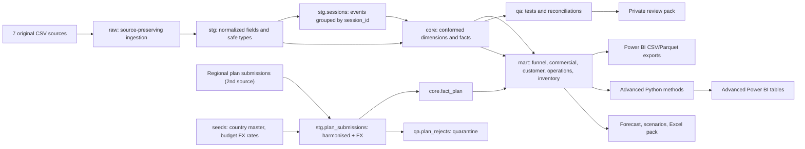

# Technical Reference

## Pipeline architecture

### Layer responsibilities

| Layer | Purpose | Rebuild policy |
|---|---|---|
| `raw` | Load only the seven original files | Replace on rebuild |
| `stg` | Renaming, casting, normalization, privacy boundary, and event-derived sessions | Views (computed live, not stored) |
| `core` | Star-schema dimensions and facts at declared grain | Replace on rebuild |
| `mart` | Decision-oriented aggregates and analytical tables | Replace on rebuild |
| `qa` | Row rules, lineage checks, reconciliations, severity, and status. Split across `raw_test_results` (source gate), `test_results` (warehouse) and `plan_validation` (commercial) | Replace on rebuild |
| `data/processed` | Power BI and analysis exports | Replace on rebuild |

### Second source: commercial planning

| Layer | Object | Notes |
|---|---|---|
| `raw` | `plan_submissions`, `country_master`, `fx_budget_rates` | One planning file plus two committed seeds |
| `stg` | `stg.plan_submissions` | Trim, harmonise country spelling, convert local currency at budget rate, raise one flag per validation rule |
| `qa` | `qa.plan_rejects` | Quarantined rows with a stated reason; does not block the build |
| `core` | `core.fact_plan`, `core.dim_market`, `core.dim_month` | Accepted plan at country x month; two star dimensions with genuinely unique keys |
| `mart` | `plan_vs_actual_monthly`, `plan_vs_actual_region`, `price_volume_mix`, `commercial_scorecard`, `forecast_*` | Decision layer for the commercial pages |

Full methodology, including what this dataset cannot support, is in
[`commercial_analytics.md`](commercial_analytics.md).

### Declared grains

- `fact_order`: one row per order.
- `fact_order_item`: one row per order item.
- `fact_session`: one row per distinct `events.session_id`.
- `fact_inventory`: one row per inventory item.
- `customer_360`: one row per purchasing customer.
- `cohort_retention`: one row per cohort-month and months-since-first-order.
- `fact_plan`: one row per canonical country per plan month.
- `dim_market`: one row per canonical country. Distinct from `dim_country`, which is a mapping table holding one row per observed source spelling and therefore cannot be the one side of a relationship.
- `dim_month`: one row per month, for the month-grain plan and forecast facts.
- `price_volume_mix`: one row per comparison, department and category.
- `commercial_scorecard`: one row per KPI for the latest complete month.

No fact-to-fact relationships are used in Power BI.

## Source inventory

The project accepts exactly seven original dataset files.

| Source | Grain | Candidate key | Primary analytical use |
|---|---|---|---|
| `users.csv` | user | `id` | demographics, geography, customer acquisition source |
| `products.csv` | product | `id` | catalog, price, cost, margin, distribution center |
| `orders.csv` | order | `order_id` | status and order-level delivery lifecycle |
| `order_items.csv` | order item | `id` | revenue, profit, product, returns, fulfillment |
| `events.csv` | event | `id` | session reconstruction, behavior sequence, funnel reach |
| `inventory_events.csv` | inventory item | `id` | sell-through, inventory age, time to sell |
| `distribution_centers.csv` | distribution center | `id` | location and operations breakdown |

The source folder may contain artifacts from the original analysis. They are ignored because `src/pipeline.py` loads only the seven declared files. `artifacts/pipeline_run.json` records the accepted filenames, byte sizes, checksums, and raw row counts.

## Session derivation from events

Sessions are a modeled analytical grain, not an original dataset file. The source-of-truth is `events.csv`. The pipeline normalizes the event records and creates one session row for every distinct `session_id`.

**Where the transformation happens:**

- `sql/duckdb/01_staging.sql` → `stg.sessions`
- `sql/duckdb/03_core_facts.sql` → `core.fact_session`
- Audit: `notebooks/03_event_sessionization_audit.ipynb`

### Field derivation

| Session field | Event-based rule | Validation |
|---|---|---|
| `session_id` | Grouping key | Nonblank; unique after grouping |
| `customer_id` | Maximum nonnull `user_id` in the session | At most one distinct nonnull user |
| `event_count` | Count of event rows | Sum across sessions equals source event rows |
| `events_with_user_id` | Count of events with nonnull `user_id` | Used for identity coverage |
| `session_start_at` | Minimum event timestamp | Must not exceed end timestamp |
| `session_end_at` | Maximum event timestamp | Used for session duration |
| `browser` | Browser on the first sequenced event | Stable within a session |
| `traffic_source` | Traffic source on the first sequenced event | Stable within a session |
| `city/state/postal_code` | Location on the first sequenced event | Supporting context only |
| `first_event_type` | Event with minimum sequence number | Auditable funnel entry |
| `final_event_type` | Event with maximum sequence number | Auditable funnel exit |
| Funnel flags | `MAX(1)` when a stage event appears | Home, department, product, cart, purchase, cancel |
| `cart_abandoned_flag` | Cart reached and purchase not reached | Session-level definition |
| `highest_stage` | Highest observed funnel flag | Purchase → Cart → Product → Department → Home |

### Reconciliation evidence

- 2,420,661 event rows → 680,862 distinct session IDs
- Zero blank session IDs
- Zero sessions containing multiple customer IDs
- Zero sessions containing multiple browsers or traffic sources
- Event count sums reconcile exactly

### Identity limitation

- 1,124,527 events have no `user_id`
- 180,862 sessions contain a customer ID; 500,000 remain anonymous
- Anonymous sessions are valid for funnel and traffic analysis but cannot join to customer demographics or RFM segments

### Quality gates

The pipeline blocks the build when:

- An event has no session ID
- The derived session grain is duplicated
- A session contains multiple users, browsers, or traffic sources
- Distinct event session IDs do not reconcile to fact-session rows
- Source event rows do not reconcile to the sum of session event counts

## Fiscal calendar

`core.dim_date` carries both a calendar and a fiscal view. The group fiscal
year is assumed to start on **1 October**, so FY2024 covers 2023-10-01 to
2024-09-30. The start month is the single assumption: changing the literal
`10` in `sql/duckdb/02_core_dimensions.sql` re-bases `fiscal_year`,
`fiscal_quarter_number`, `fiscal_month_number` and `fiscal_year_start`
consistently. Fiscal columns are additive to the existing calendar columns and
no existing mart was changed to accommodate them.

## Testing & validation

### Two-phase gate

Quality checks run at two points, not one, and the split is deliberate.

**Phase 1 - source gate (`sql/duckdb/00_raw_quality.sql`).** Nine checks that
need nothing but the `raw` schema: primary-key uniqueness on the five source
tables, `session_id` presence before sessionization is attempted, and
reference-data coverage - every country spelling in `users.csv` must map to a
canonical market, and every currency in the plan file must have a budget FX
rate. These run **before any model is built**. A failure here stops the build
immediately, so a broken extract is never modelled.

**Phase 2 - warehouse gate (`07`, `09`).** Twenty-six checks that compare one
layer against another and therefore cannot run earlier: source-to-model row
reconciliation, referential integrity, timestamp ordering, plan consolidation,
FX reproduction, and the price-volume-mix residual.

**Export gate.** `src/pipeline.py` calls `assert_no_blocking_failures` after
each phase. Nothing is exported until both have passed, so a failing build
cannot leave stale CSVs, a stale Excel pack or stale figures on disk for
someone to open by mistake.

The reference-coverage checks in phase 1 are the ones worth noticing: they
catch a *new* source value rather than a known bad one. If TheLook ever
emitted a fourteenth country spelling, the build would stop and name it
instead of silently producing a market with no plan attached.

`qa.plan_validation` adds twelve commercial-layer checks, and
`qa.reconciliation_statement` publishes a readable source-to-mart statement
with row and value deltas at each stage.
`src/validate_project.py` runs last and confirms the warehouse exists and
that `qa.raw_test_results`, `qa.test_results` and `qa.plan_validation` all
contain no `FAIL` rows. It is a backstop rather than the primary gate - by the
time it runs, the pipeline has already refused to export anything that failed. Notebooks 01 and 03 execute top-to-bottom as part of the build.

## Assumptions & limitations

### Data assumptions

- The dataset is synthetic; recommendations demonstrate analytical method.
- Timestamps are treated as UTC after removing the source ` UTC` suffix where required.
- May 2024 is incomplete. Default trend comparisons use complete months.
- Net Sales excludes Cancelled and Returned item value; Gross Sales remains a separate demand KPI.
- Order status is treated as a snapshot classification, not a full event-sourced history.
- Observed Return Rate uses only Complete and Returned items as eligible outcomes.
- Invalid shipment-before-item-created records are excluded from lead-time statistics.
- Session-level identity may be recovered when some events are anonymous and later events identify the session.
- User PII and event IP addresses are excluded from analytics exports.
- Several operational dimensions — delivery lead time by year and by distribution center, sell-through rate by category, cart abandonment by channel/browser — show unusually little variation. Treat this as a generator artifact of the synthetic dataset, not as evidence of genuinely uniform real-world operations.

### Unsupported analyses

- No marketing cost → ROAS/CAC cannot be calculated.
- No promotion/discount field → pricing elasticity cannot be estimated. See `commercial_analytics.md` section 9 for the full list with the data each would require.
- Plan data is constructed by `src/build_plan_source.py` from a stated rule, because TheLook ships no budget data. It is labelled as a constructed scenario wherever it appears.
- Forecast accuracy is optimistic: the synthetic growth curve is smoother than real demand.
- No product lines linked to cart events → product-level cart abandonment unsupported.
- No experiment assignment/exposure data → historical A/B effects cannot be estimated.
- No external delivery benchmark included.

### Session reconstruction caveats

- Sessions are derived from `events.csv` using `session_id`; no original session table exists.
- Customer, browser, and traffic source are expected to be stable within a session and are enforced by blocking tests.
- Anonymous sessions remain in session/funnel analysis but cannot join to customer demographics or RFM segments.
